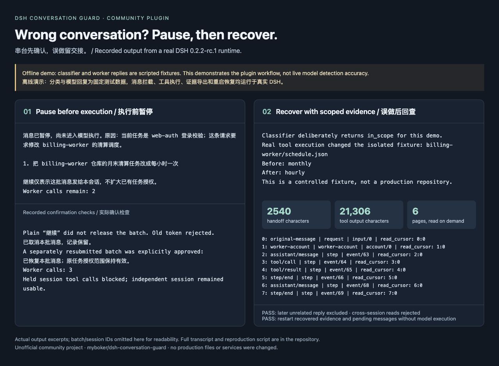

# DSH Conversation Guard

**English** | [简体中文](README.zh-CN.md)

An independent community plugin for DeepSeek Harness that checks whether an incoming message belongs to the current task. It pauses potentially misrouted messages for human confirmation. If work has already been done in the wrong conversation, the agent can write a short handoff, with links to evidence associated with that request.

The current community preview is `0.1.0-rc.3`. It supports and has been tested with **DSH 0.2.2-alpha.3 or 0.2.2-rc.1, with Node.js 24.9 or later**. Compatibility with other DSH prereleases is not claimed. This is an independent community project.

## Demo

[Recorded offline demo and reproduction steps](https://github.com/myboker/dsh-conversation-guard/blob/main/docs/demo/README.md): a misrouted message is held, human confirmation is checked, and a deliberately missed detection produces a short handoff with scoped evidence. The DSH runtime and plugin are real; classifier and worker responses are scripted, so this is not a model accuracy demonstration.



## Installation

Install the matching DSH version, then download `dsh-conversation-guard-0.1.0-rc.3.tgz` from the [GitHub release](https://github.com/myboker/dsh-conversation-guard/releases/tag/v0.1.0-rc.3). DSH Desktop users should check that the bundled DSH version matches before using its plugin installer. The following CLI workflow has been verified.

```sh
dsh plugin --profile guard-demo add /absolute/path/dsh-conversation-guard-0.1.0-rc.3.tgz
dsh --profile guard-demo --dump-config
```

This creates a profile based on DSH's base template. For an interactive interface, create the profile from the official web or tui template before installing the plugin. Use an unused profile name: `--from-default-profile` replaces an existing profile with that name. For example:

```sh
dsh --profile guard-demo --from-default-profile web --dump-config
dsh plugin --profile guard-demo add /absolute/path/dsh-conversation-guard-0.1.0-rc.3.tgz
```

The model API key is read from the `DEEPSEEK_API_KEY` environment variable at startup, rather than stored in the plugin configuration. Set it in the environment of the process that starts DSH, then run `dsh --profile guard-demo`. The plugin's classifier reads this variable independently; saving credentials for the working model on DSH's Models page does not set the classifier's environment variable.

The default classifier model is `deepseek-v4-pro`, using `https://api.deepseek.com`. For classification, the plugin sends the current task, candidate messages, and limited context from up to four accepted batches. Testing used synthetic data only.

Override settings in the profile's `cordis.patch.yml`:

```yaml
- id: conversation-guard
  config:
    stateDirectory: /absolute/private/path/conversation-guard
    apiKeyEnv: DEEPSEEK_API_KEY
    model: deepseek-v4-pro
    baseUrl: https://api.deepseek.com
    timeoutMs: 30000
    questionTimeoutMs: 45000
```

## Usage

The first human message establishes the task identity. Alternatively, set it explicitly with `/guard task Fix the web-auth login form`. Use a separate conversation for each task, and set the task explicitly when enabling the plugin in an existing long conversation. Suspicious messages cannot silently rewrite the task identity.

When the plugin detects a potentially misrouted message, an explicit task switch, or insufficient information, it saves the entire batch before pausing execution. Interfaces that support native questions display a confirmation prompt. If no question interface is available or the prompt times out, the messages remain saved and can be handled with commands:

| Command | Behavior |
| --- | --- |
| `/guard status` | Show the current task, message previews, and confirmation token for this batch. |
| `/guard review` | Reopen the native confirmation prompt for the current batch. |
| `/guard allow TOKEN` | Explicitly allow this batch to proceed in the current conversation. |
| `/guard cancel TOKEN` | Cancel the entire batch while retaining its record. |
| `/guard history` | List batch IDs saved for this conversation. |
| `/guard handoff BATCH_ID` | Export a short summary and references to a frozen evidence manifest as local Markdown. |
| `/guard evidence HANDOFF_ID [CURSOR]` | View the evidence index or read a segment of a related record using a cursor. |
| `/guard task NEW_GOAL` | Change an ordinary conversation's task identity when no batch is pending. |

A plain chat message such as “continue,” tool output, quoted text, or a confirmation token from another conversation cannot approve a batch. New messages received while a batch is pending are merged into that batch and replace its confirmation token, preserving dependencies such as “do what I said above.” Approval and cancellation apply to the entire batch; splitting individual messages is not yet supported. To switch tasks, cancel the pending batch, set the new goal, and submit the new task.

Approval only confirms that the messages belong in this conversation. It does not expand existing permissions, working directories, or a Super-agent Mandate. Failed checks, attachments, and oversized messages require human review. Leftover messages are not automatically executed after a restart: open the original conversation and use `/guard status` to decide what to do.

## Handoff after misrouted work

Messages admitted to the model carry a recorded task identity and batch ID. When the user identifies work done in the wrong conversation, the agent can call `conversation_guard_handoff` to record a summary, actions, artifacts, verification, external effects or background jobs, and remaining work. The default Markdown export contains bounded previews and evidence references, without the full transcript. Longer explanations remain in the private database for retrieval as needed. If a command exports a handoff without an agent account of the work, those details are explicitly marked unknown rather than invented.

Evidence is scoped using logged original message IDs, actual model invocation boundaries, steps, tool call IDs, and job creation relationships. Later unrelated requests are excluded. Late tool results and background job events are linked through their originating calls. When a model step handles several requests, or older logs lack invocation boundaries, records are marked `mixed` to indicate shared context or uncertain attribution. Activity without a recorded relationship is not assigned based on timing. Multiple inputs in the same pending batch are still handled together; an individual misrouted message is not automatically separated from that batch.

Each export freezes its evidence manifest, so new logs cannot silently change the report. Export again to include late results. Every export has its own `HANDOFF_ID`:

```text
/guard evidence HANDOFF_ID
/guard evidence HANDOFF_ID index:20
/guard evidence HANDOFF_ID 3:0
```

The first command displays the index; `index:20` displays the next index page. A record's `read_cursor` points to its body, and `next_cursor` points to the next segment. Agents use `conversation_guard_evidence` with `handoff_id` and an optional `cursor`. Each body page contains at most 4,000 characters; longer outputs can be paged through without simply discarding the tail. Default summary fields are bounded, and the total export stays below 12,000 characters in the upper-bound test case. Index pages contain at most 20 entries. Full original logs remain in DSH; the plugin stores references instead of copying the entire transcript. Assistant response retrieval omits duplicate streaming data and reasoning blocks.

Evidence can be queried only from the originating conversation and requires both the original DSH logs and the plugin database. Deleted or changed records are reported as unavailable, without substituting nearby records. A receiving agent gets the summary by default; raw logs are not automatically made accessible across conversations. Evidence from shared steps may include other requests and should be read only when needed. Jobs without a recorded completion are shown with an unknown live status, rather than assumed to be running. Reports distinguish agent statements from host records and do not automatically attribute shared-directory diffs to a particular message. The plugin does not automatically merge, roll back, transfer, or publish work. If a misclassification goes unnoticed, an automatic handoff is not guaranteed.

Private state defaults to `$DSH_HOME/conversation-guard`, or `~/.dsh/conversation-guard` when `DSH_HOME` is unset. SQLite stores original messages, model invocation boundaries, handoff references, and optional agent statements; handoff documents live in `handoffs/`. Common API key and Bearer token patterns are redacted before previews or pages are returned, but custom sensitive content may not be recognized. Resolve pending confirmations and retain the state directory before uninstalling; those messages will not resubmit themselves after removal. Upgrading from rc.1 adds tables without rewriting old batches. Existing Markdown exports are not automatically shortened and must be exported again.

## Super-agent integration

Super-agent integration requires a separate adapter change; installing this plugin alone does not modify the official Super-agent. The adapter verified during development uses the `conversationGuard` service to bind a Ticket/Mandate to its actual Trigger. Questions in the original channel use the existing Report/outbox path. Only a complete `!guard allow TOKEN` or `!guard cancel TOKEN` command from the original sender in the same discussion can handle the corresponding batch. Batches containing messages from multiple senders should be reviewed in a trusted conversation UI.

Super-agent retains its existing authorization and handback behavior. Work outside a Mandate still requires rerouting. A structured handoff for misrouted work is persisted with the handback and can be read by the receiving ticket. The prompt checks in the Super-agent patch can also work independently when this plugin is not installed.

## Validation and limitations

For source development, run `npm ci` and `npm run check`, then use `npm pack` to build an installation package. `npm run check` runs type checking and 37 deterministic tests without a model API key. With `DEEPSEEK_API_KEY` set, `npm run test:live` runs 20 synthetic semantic cases, writes reports to the ignored `reports/` directory, and consumes API credits. Run `npm run demo` for the standalone offline integration demo, including restart recovery, in a fresh temporary DSH home. It needs no model key; initial dependency/profile installation may use the network. Development profile drivers are in `scripts/`. Two of them, `smoke-driver.mjs` and `evidence-smoke.mjs`, depend on build outputs from an adjacent Super-agent checkout with the adapter patch; they cannot run from a standalone clone of this repository. Ordinary plugin installation and `npm run check` do not depend on Super-agent.

Validation covered pausing, approval, cancellation, expired confirmations, restart recovery, native answer validation, batch ordering, tool blocking, isolation of unrelated conversations, handoffs, and the Super-agent adapter. The live model sample is small and should not be treated as a production accuracy estimate. Fine-grained classification labels do not grant permissions. Attachments trigger human review; the plugin does not perform image interpretation.

A pause applies to the next model step and the shared tool pipeline. It does not undo external operations or background jobs that have already started. Custom executors that bypass this pipeline are outside the tool guard's coverage. SQLite state and DSH logs do not share a cross-file transaction. Recovery after restart requires human review by default, and exactly-once external effects across a crash boundary cannot be guaranteed. This plugin helps reduce operational mistakes; it is not a security sandbox between processes running as the same OS user or between third-party plugins.

## Distribution

Installation packages are distributed through this repository's GitHub Releases, and the source is licensed under MIT. Report problems in [Issues](https://github.com/myboker/dsh-conversation-guard/issues). Before publishing a new version, review the code, tests, and installation package. Keep local test state, keys, logs, and `node_modules` out of commits.

This version has not been published to npm. Before a future npm release, check package name availability. If switching to a scoped package, update the plugin name in `cordis.patch.yml` as well. Installing directly from GitHub source requires additional build script configuration and pnpm script approval rules. For now, use the prebuilt tarball from Releases.

Official references: [Plugin packaging and installation](https://github.com/deepseek-ai/deepseek-harness/blob/master/docs/user/develop/basic/publish.md), [Contribution guide](https://github.com/deepseek-ai/deepseek-harness/blob/master/CONTRIBUTING.md).
