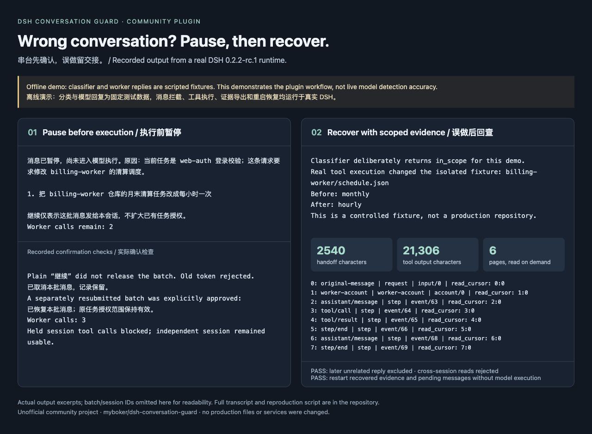

# DSH Conversation Guard

[English](README.md) | **简体中文**

一个独立的 DeepSeek Harness 社区插件：根据当前任务判断新消息是否可能发错会话，暂停可疑消息，请人确认；误做后由 agent 写简短交接说明，插件提供与该请求关联的证据查询入口。

当前社区预览版为 `0.1.0-rc.3`。支持并测试 **DSH 0.2.2-alpha.3 或 0.2.2-rc.1、Node.js 24.9 及以上**；不声明兼容其他预发行版本。本项目是独立社区插件。

## 演示

[离线演示记录与复现步骤](https://github.com/myboker/dsh-conversation-guard/blob/main/docs/demo/README.md)：展示串台消息暂停、人类确认，以及故意模拟漏判后的简短交接和证据回查。DSH 运行时和插件均为实际运行，分类器和工作模型使用固定回复，因此这不是模型识别准确率演示。



## 安装试用

先安装对应版本的 DSH，再从 [GitHub Release](https://github.com/myboker/dsh-conversation-guard/releases/tag/v0.1.0-rc.3) 下载 `dsh-conversation-guard-0.1.0-rc.3.tgz`。已有 DSH Desktop 的用户，应确认内置版本匹配，再使用它提供的插件安装入口；下面是已验证的 CLI 流程。

```sh
dsh plugin --profile guard-demo add /absolute/path/dsh-conversation-guard-0.1.0-rc.3.tgz
dsh --profile guard-demo --dump-config
```

这会创建基于 DSH base 的 profile。若需要交互界面，先从官方 web 或 tui 模板创建该 profile，再安装插件。请使用尚未存在的 profile 名称，`--from-default-profile` 会替换同名的已有 profile。例如：

```sh
dsh --profile guard-demo --from-default-profile web --dump-config
dsh plugin --profile guard-demo add /absolute/path/dsh-conversation-guard-0.1.0-rc.3.tgz
```

模型密钥从启动环境变量 `DEEPSEEK_API_KEY` 读取，不写入插件配置。请在启动 DSH 的进程环境中设置它，然后运行 `dsh --profile guard-demo`。插件的分类器独立读取该变量；仅在 DSH Models 页面保存工作模型凭据，不等于已经为分类器设置环境变量。

默认分类模型为 `deepseek-v4-pro`，接口为 `https://api.deepseek.com`。插件会发送当前任务、候选消息及最多四个已接受批次的有限上下文进行判断。测试仅使用合成数据。

可在 profile 的 `cordis.patch.yml` 覆盖配置：

```yaml
- id: conversation-guard
  config:
    stateDirectory: /absolute/private/path/conversation-guard
    apiKeyEnv: DEEPSEEK_API_KEY
    model: deepseek-v4-pro
    baseUrl: https://api.deepseek.com
    timeoutMs: 30000
    questionTimeoutMs: 45000
```

## 使用

第一条人类消息建立任务身份；也可以先输入 `/guard task 修复 web-auth 登录表单`。建议每个任务使用独立会话，并在已有长会话启用插件时先明确设置任务。任务身份不会被可疑消息悄悄改写。

检测到疑似误发、明确换任务或信息不足时，插件先保存完整批次，再暂停执行。支持原生问答的界面会弹出确认；没有问答界面或问答超时，消息仍保留，使用命令处理：

| 命令 | 行为 |
| --- | --- |
| `/guard status` | 查看当前任务、消息预览和本批确认编号 |
| `/guard review` | 重新打开当前批次的原生确认 |
| `/guard allow TOKEN` | 明确允许这一批消息在当前会话继续 |
| `/guard cancel TOKEN` | 取消整批，保留记录 |
| `/guard history` | 列出本会话保存的批次编号 |
| `/guard handoff BATCH_ID` | 导出简短摘要与冻结的证据查询入口到本地 Markdown |
| `/guard evidence HANDOFF_ID [CURSOR]` | 查看证据目录，或按游标读取一段相关记录 |
| `/guard task 新目标` | 无待处理批次时修改普通会话的任务身份 |

普通聊天里的“继续”、工具输出、引用文字和其他会话的确认编号都不能放行。待处理期间收到新消息会合并到同一批次并更换确认编号，保留“照上面做”等依赖关系。取消和批准均针对整个批次；暂不支持单条拆分。真正切换任务时，先取消待处理批次，设置新目标，再提交新任务。

批准仅确认消息归属，不扩大已有权限、工作目录或 Super-agent Mandate。检查失败、附件或超长消息需要人工处理。重启后不自动执行遗留消息：打开原会话，使用 `/guard status` 再决定。

## 误做后的交接

每次进入模型的消息附带一个已记录的任务身份和批次编号。用户指出误做后，agent 可调用 `conversation_guard_handoff`，填写摘要、操作、产物、验证、外部效果/后台作业及剩余工作。默认 Markdown 只显示有限预览和证据入口，不附整段日志；长说明保留在私有数据库，可按需查看。命令导出没有 agent 说明时，会明确标为未知，不自行编造完成情况。

证据范围由已经入日志的原消息 ID、实际模型调用边界、步骤、工具 call ID 和作业创建关系确定。后续新一轮无关请求不纳入；工具结果和后台作业即使晚到，也按其创建调用关联。一次模型步骤同时处理多个请求，或旧日志缺少调用边界时，记录标为 `mixed`，表示共同上下文或不确定归属。没有关联依据的活动不按时间猜测。多个输入在同一待处理批次中仍然整体处理，暂不自动拆出其中单条误发消息。

导出会冻结证据目录，之后的新日志不会悄悄改变原报告；需要补上晚到结果时重新导出。每个导出有独立 `HANDOFF_ID`：

```text
/guard evidence HANDOFF_ID
/guard evidence HANDOFF_ID index:20
/guard evidence HANDOFF_ID 3:0
```

第一条查看目录，`index:20` 查看下一组目录；记录的 `read_cursor` 指向正文，`next_cursor` 指向后续分段。agent 使用 `conversation_guard_evidence`，参数为 `handoff_id` 和可选 `cursor`。每次正文最多 4,000 字符，大段输出可以继续翻页，不会只截去结尾。默认摘要字段受限，总长度在上限用例中小于 12,000 字符；目录每页最多 20 条。完整原日志留在 DSH，插件保存引用，不复制全量日志；查询助手回复时省略重复流数据和 reasoning 块。

证据查询仅限原会话，读取需保留 DSH 原日志和插件数据库；删除或变化的记录会明确报缺失，不用邻近记录替代。接手 agent 默认拿到摘要；跨会话原始日志不自动开放。共享步骤的证据可能包含其他请求，需要时才读取。没有结束记录的作业会显示“实时状态未知”，不会被认定仍在运行。文档区分 agent 自述与主机记录，不把共享目录 diff 自动归属给某条消息。插件不自动合并、回滚、转交或发布；模型漏判且无人发现时，不保证自动触发交接。

默认私有状态位于 `$DSH_HOME/conversation-guard`，未设置 `DSH_HOME` 时位于 `~/.dsh/conversation-guard`。SQLite 中保存原消息、模型调用边界、交接引用和可选 agent 自述；交接文档在 `handoffs/`。常见 API key/Bearer 字符串在输出预览或分页前脱敏，不能保证识别所有自定义敏感内容。卸载前处理待确认消息并保留状态目录；卸载后这些消息不会自行重投。升级 rc.1 使用新增表，不重写旧批次；旧 Markdown 不会自动缩短，需重新导出。

## Super-agent 适配

Super-agent 接入需要额外的适配改动；仅安装本插件不会修改官方 Super-agent。开发中验证的适配层通过 `conversationGuard` 服务绑定 Ticket/Mandate 和真实 Trigger。原渠道提问沿用 Report/outbox；只有原发送者在同一讨论中发出的完整 `!guard allow TOKEN` / `!guard cancel TOKEN` 命令能处理对应批次。多个不同发送者混合的批次应在受信任的会话 UI 审阅。

Super-agent 保留原有授权和 handback。任务超出 Mandate 时仍需重新路由；误做后的结构化交接随 handback 持久保存，并能被接手 ticket 读取。未安装本插件时，Super-agent 补丁中的提示词检查仍可独立使用。

## 验证与边界

从源码开发时，运行 `npm ci`、`npm run check`，再用 `npm pack` 生成安装包。`npm run check` 运行类型检查和 37 项确定性测试，不需要模型密钥。`DEEPSEEK_API_KEY` 已设置时，`npm run test:live` 运行 20 个合成语义案例，报告写入忽略的 `reports/`，会消耗 API 额度。运行 `npm run demo` 可在全新的临时 DSH 目录中复现独立离线集成演示及重启恢复，不需要模型密钥；首次安装依赖或 profile 时可能联网。开发用 profile 驱动见 `scripts/`；其中 `smoke-driver.mjs` 和 `evidence-smoke.mjs` 依赖相邻、带适配补丁的 Super-agent checkout 构建产物，单独克隆本仓库不能直接运行这两份集成脚本。普通插件安装和 `npm run check` 不依赖 Super-agent。

已验证消息暂停、批准、取消、过期确认、重启恢复、原生回答校验、批次顺序、工具阻断、独立会话不受影响、交接与 Super-agent 适配。真实模型样本规模较小，不能视为生产环境准确率；细分类结果不用于授权。附件只做人工暂停，不进行图像语义判断。

暂停作用于下一模型步骤及共享工具管线；已开始的外部操作和后台作业不会被撤销。自定义 executor 若绕过该管线，不受工具 guard 保护。SQLite 状态与 DSH 日志并非一个跨文件事务；重启默认人工恢复，不能承诺崩溃边界上的外部效果 exactly-once。本插件帮助减少操作失误，不是同一操作系统用户或第三方插件之间的安全沙箱。

## 发布

安装包通过本仓库 GitHub Releases 分发，源码采用 MIT 许可证。问题反馈请到 [Issues](https://github.com/myboker/dsh-conversation-guard/issues)。维护版本时先 review 代码、测试和安装包，不要提交本地测试状态、密钥、日志或 `node_modules`。

本版本没有发布到 npm。后续发布 npm 前需确认包名可用；若改为 scoped 包，同时修改 `cordis.patch.yml` 的插件名。直接从 GitHub 源码安装需要另外配置构建脚本及 pnpm 的脚本允许规则；当前使用 Release 中已经构建的 tarball。

官方参考：[插件打包与安装](https://github.com/deepseek-ai/deepseek-harness/blob/master/docs/user/develop/basic/publish.md)、[贡献说明](https://github.com/deepseek-ai/deepseek-harness/blob/master/CONTRIBUTING.md)。
