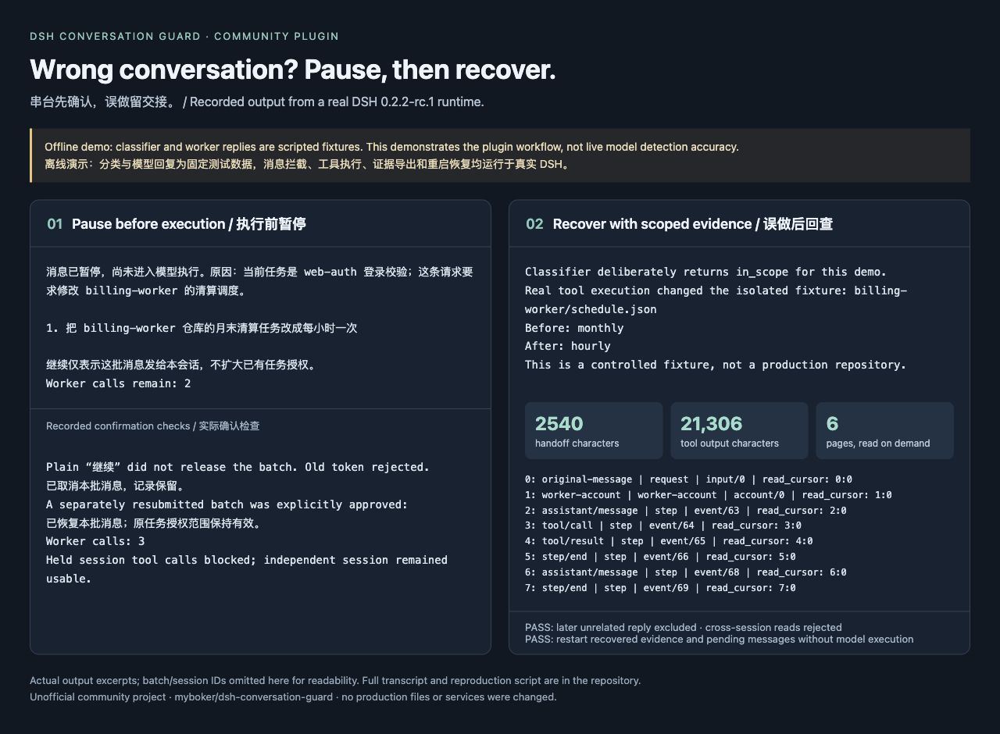

# Recorded offline demo / 离线演示记录

[English README](../../README.md) · [中文说明](../../README.zh-CN.md)

This demo runs the actual DSH agent loop, installed Conversation Guard bundle, tool pipeline, session logs, and SQLite journal. Classifier responses, worker responses, and the handoff account are scripted fixtures. It demonstrates workflow behavior, **not live model detection accuracy**. The image below is a rendered excerpt of recorded output, not the native DSH interface.

演示使用真实 DSH 消息循环、已安装插件、工具执行管线、会话日志和 SQLite 状态。分类器回复、工作模型回复和交接自述由脚本固定，用于稳定复现流程，**不代表真实模型的识别准确率**。下图是实际输出节选的排版截图，不是 DSH 原生界面。



## What happens / 演示过程

1. Establish a login-validation task and accept a relevant follow-up. / 建立登录校验任务，正常跟进进入工作模型。
2. Submit a billing-schedule request; the scripted classifier reports a mismatch. The plugin holds it before the worker runs. / 提交账单调度请求，分类器固定返回串台判断，插件在执行前暂停。
3. A plain “继续” does not approve the batch and invalidates the old token. Cancel that batch, then explicitly approve a separately submitted batch. Tools are blocked in the held session while an independent session remains usable. / 普通“继续”不放行，旧确认编号失效；验证取消和明确批准，以及暂停会话的工具阻断和独立会话不受影响。
4. Deliberately simulate a false negative. A real tool changes only an isolated temporary `billing-worker/schedule.json` fixture from `monthly` to `hourly`. / 故意模拟漏判，真实工具只修改临时目录中的调度样例。
5. Send a later, unrelated login follow-up, then export a short handoff for the earlier billing request. Read its tool result page by page. / 随后加入另一条登录请求，再针对先前的账单请求导出交接，按需分页读取工具结果。
6. Restart DSH in a new process. Recover the pending message and the same frozen evidence without calling the worker. / 新进程重启后，待确认消息和原证据仍可读取，工作模型没有自动执行。

## Observed results / 实测结果

Recorded on 2026-11-05 using Node.js **v26.0.0**. Both DSH environments used the same plugin tarball. Each compatibility run used separate dependencies, a fresh profile, and a separate state directory.

| Check / 检查 | DSH 0.2.2-alpha.3 | DSH 0.2.2-rc.1 |
| --- | --- | --- |
| Type check + deterministic tests / 类型与确定性测试 | 37 passed | 37 passed |
| Tarball installation + actual agent loop / 安装包与真实消息循环 | Passed | Passed |
| Hold, cancel, explicit approval, stale token / 暂停、取消、批准、过期确认 | Passed | Passed |
| Tool blocking + independent session / 工具阻断与独立会话 | Passed | Passed |
| Scoped evidence + cross-session rejection / 限定证据与跨会话拒绝 | Passed | Passed |
| Pending-message and evidence recovery after restart / 重启恢复 | Passed | Passed |

The recorded rc.1 run produced a **2,540-character Markdown handoff** for a **21,306-character tool output**, read in **6 pages**. The final marker was preserved, and a later unrelated reply was absent from every evidence page. These are fixture-specific measurements, not general compression or detection-rate claims. The original output remains available through the evidence references.

rc.1 演示中，**21,306 字符的工具输出**对应默认 **2,540 字符交接文档**，原工具结果按需分 **6 页**读全，末尾标记保留；后续无关回复没有出现在任何证据页中。这些数字仅描述本次样例，不是通用压缩率或识别率。原始内容通过证据入口按需读取。

- [Full recorded transcript / 完整演示输出](transcript.txt)
- [Generated handoff / 实际生成的交接样例](handoff.md)

All published content is synthetic. The temporary local root is replaced with `<DEMO_HOME>`; synthetic IDs are retained. Those IDs refer to the recorded local run and cannot be queried in someone else's installation.

发布内容均为合成测试数据。临时目录替换为 `<DEMO_HOME>`，合成会话编号保留；这些编号只属于当次本地测试，不能在其他人的安装中直接查询。

## Reproduce / 复现

From a clone of this repository, with Node.js **24.9+** and `pnpm` available:

```sh
npm ci
npm run check
npm run demo
```

To test the packaged bundle instead of loading local build output:

```sh
npm pack
node scripts/demo.mjs --package ./dsh-conversation-guard-0.1.0-rc.3.tgz
```

The runner prints its output directory and fresh temporary DSH home. No model API key is needed and no paid API is called. Dependency/profile installation may access the package registry. The runner removes `DEEPSEEK_API_KEY` from its child process, uses a scripted `.invalid` classifier endpoint, and restricts fixture edits to the temporary home. Original DSH user profiles are not used. Remove the printed temporary directory when finished if you do not need its logs or evidence. `reports/` is ignored by Git.

脚本会输出记录目录及全新的临时 DSH 目录。不需要模型密钥，也不调用付费 API；安装依赖或 profile 时可能访问包仓库。子进程移除 `DEEPSEEK_API_KEY`，分类接口为脚本接管的 `.invalid` 地址，样例修改仅发生在临时目录内，不使用原有 DSH 用户 profile。确认不再需要回查后可删除打印的临时目录，`reports/` 不会提交到 Git。

Super-agent adaptation remains a separate development patch and is not part of this standalone demo or installation package. / Super-agent 适配仍是独立开发补丁，不包含在此演示或安装包中。
